<p align="center">
  
</p>

<p align="center">
  
  
  
  
  
  <a href="https://www.buymeacoffee.com/miteshviras329"></a>
</p>

<p align="center">
  <a href="#-quick-start-under-2-minutes"><b>Quick start</b></a> ·
  <a href="#-see-it-in-action"><b>Demo</b></a> ·
  <a href="#-where-your-ledger-lives"><b>Destinations</b></a> ·
  <a href="#-plugin-ledger-vs-the-alternatives"><b>Compare</b></a> ·
  <a href="#-faq"><b>FAQ</b></a> ·
  <a href="#-reference"><b>Reference</b></a>
</p>

---

**plugin-ledger** is a **ledger plugin for plugin management** across AI coding agents. It keeps one inventory of every **plugin, skill and MCP server** you've installed in **Claude Code, Antigravity, Gemini CLI, opencode, GitHub Copilot and Codex**, as an Excel file or a Google Sheet, so you never forget what a plugin is for.

You install a plugin from a **plugin marketplace**, use it once, and a month later you have no idea what it does or where it came from. plugin-ledger remembers for you:

- 🔗 **Where it came from:** the marketplace or repository link
- 📅 **When you installed it,** and when you removed it
- 💡 **What it's for:** the description and each skill's "Use when…" sentence
- 🤖 **Which agent has it:** one row per agent, including every **MCP plugin** (MCP server)
- 🧾 **History:** uninstalled items stay as **Removed**, so your personal **plugin registry** never forgets

## ⚡ Quick start (under 2 minutes)

**1. Install** (about 30 seconds). Run these from a terminal:

```
claude plugin marketplace add miteshviras/plugin-ledger
claude plugin install plugin-ledger@plugin-ledger
```

Or type `/plugin marketplace add miteshviras/plugin-ledger`, then `/plugin install plugin-ledger@plugin-ledger`, on their own in Claude Code's message box.

**2. Start a new session and answer two questions** (about 30 seconds):

| | Question | Your options |
|---|---|---|
| 1️⃣ | **Where?** | Claude folder *(recommended)* · a folder you choose · Google Drive |
| 2️⃣ | **Name?** | `plugin-ledger` *(recommended)* or your own. Fixed from then on. |

**3. Open your ledger.** It already lists everything installed in every agent, and it updates itself at each session start. Change either answer later with `/plugin-ledger:setup`.

> Choosing a local folder needs no account, no API key and no connector. Google Drive needs the Google Drive and Google Sheets connectors ([setup below](#-where-your-ledger-lives)).

## 🎬 See it in action

<p align="center">
  
</p>

<p align="center">
  
  <br><sub>Example data. Your ledger also has link, description and removed-date columns.</sub>
</p>

## 📁 Where your ledger lives

| Destination | Kept as | Needs | Updates |
|---|---|---|---|
| 💻 **Claude folder** `~/.claude/plugin-ledger/` | `<name>.xlsx` | Nothing | At session start, by the hook itself. **Zero tokens.** |
| 📂 **A folder you choose** | `<name>.xlsx` | Nothing | Same as above |
| ☁️ **Google Drive** | Google Sheet `<name>` | Google Drive + Google Sheets connectors | In Claude's first turn after a change |

The Excel file looks like a real table: dark frozen header, filters on every column, banded rows, wrapped text, and 🟢 **Installed** / 🔴 **Removed**. The Google Sheet gets the same style.

<details>
<summary><b>☁️ Using Google Drive? Connect Google first</b></summary>

<br>

1. Open **claude.ai → Settings → Connectors**.
2. Connect **Google Drive** and **Google Sheets** with the **same Google account**. The Sheets connector can only open sheets that account can access.
3. In Claude Code, run `/mcp` and check both are listed and connected.

| Connector | Why |
|---|---|
| Google Drive | Creates the sheet the first time |
| Google Sheets | Adds rows, marks removals and applies the table style on later syncs. Drive alone can create a file but can't edit one. |

You don't need a Google Cloud project, API keys or an Apps Script.

</details>

## 🧾 What the ledger looks like

| Plugin name | Type | Link | Installed | Description | Use case | Status | Removed | Agent |
|---|---|---|---|---|---|---|---|---|
| `postman@claude-plugins-official` | plugin | github.com/anthropics/claude-plugins-official | 2026-10-30 | Work with Postman from your agent… | `api-testing: Use when testing an endpoint…` | 🟢 Installed | | Claude Code |
| `antigravity:plugin:firebase` | plugin | firebase.google.com | 2026-09-17 | Prototype, build & run modern apps… | `firebase_ai_logic_basics: …` | 🟢 Installed | | Antigravity |
| `agents:skill:hyperframes` | skill | github.com/heygen-com/hyperframes | 2026-08-23 | Read first to make, edit, animate… | Read first to make, edit… | 🟢 Installed | | Shared (~/.agents) |
| `copilot:mcp:Neon` | mcp | https://mcp.neon.tech/mcp | 2026-11-23 | MCP server (remote) | | 🔴 Removed | 2026-12-02 | Copilot |

- **Description:** the plugin's or skill's own description.
- **Use case:** the "Use when…" sentence from each skill. A plugin gets one line per skill.
- **Status:** reinstall something and its row switches back to Installed.

## ⚙️ How it works

<p align="center">
  
</p>

- **Local is instant and free.** The hook writes the Excel file itself, with no Claude turn and no connector, and only when something changed.
- **Drive updates in your first turn.** Hooks can't call connectors, so Claude does the update.
- **Nothing is lost.** If the Excel file is open, or Google is unreachable, nothing is marked as done and the next session retries.

<details>
<summary><b>Show the full flow</b></summary>

<br>

```
session starts
   │
   ▼
hook: node scripts/sync.js ── scans every agent
   │
   ├─ not set up yet ──► Claude runs plugin-ledger:setup (asks where + name)
   │
   ├─ LOCAL ──► merges into ledger.json ──► rewrites <name>.xlsx
   │            (nothing changed: does nothing; no Claude, no tokens)
   │
   └─ GOOGLE DRIVE ──► compares with synced.json
          ├─ nothing changed ──► exits silently
          └─ changes ──► writes pending.json ──► Claude runs plugin-ledger:sync
                 no sheet yet: Drive creates it from CSV
                 sheet exists: Sheets appends rows, marks removals, applies the table style
                 only if every write succeeded: sync.js --commit
```

</details>

## 📤 Export CSV or JSON

CSV and JSON are **never written automatically**. Run `/plugin-ledger:export` and Claude asks each time:

| | Choose |
|---|---|
| **Format** | CSV · JSON · Excel |
| **File name** | `plugin-ledger` *(recommended)* or your own |
| **Folder** | Downloads · this project · Claude folder · any path |

It never overwrites a file without asking. The export has the full history: Installed and Removed rows from every agent.

## 🆚 plugin-ledger vs the alternatives

How else can you keep track of AI plugins and MCP servers?

| | **plugin-ledger** | Each agent's own plugin list (`/plugin`, settings) | A spreadsheet you keep by hand |
|---|:---:|:---:|:---:|
| One list across Claude Code, Antigravity, Gemini CLI, opencode, Copilot, Codex | ✅ | ❌ one agent at a time | ✅ if you add every one |
| Plugins, skills **and** MCP servers | ✅ | Varies by agent | ✅ if you add them |
| Remembers what you **removed**, and when | ✅ | ❌ gone once uninstalled | ⚠️ if you remember |
| What each plugin is **for** (use case) | ✅ pulled from each skill | ⚠️ description only | ⚠️ if you write it |
| Marketplace / source link | ✅ | ⚠️ sometimes | ⚠️ if you copy it |
| Updates itself | ✅ every session | ✅ | ❌ |
| Excel / Google Sheet / CSV / JSON | ✅ | ❌ | ✅ |
| Account or API key needed | ❌ (local) | ❌ | ❌ |
| Cost | Free, MIT | Free | Your time |

Use your agent's own list for turning a plugin on or off. Use plugin-ledger to remember what you have, why you installed it, and what you removed.

## ❓ FAQ

<details>
<summary><b>Is plugin-ledger a plugin marketplace?</b></summary>

<br>

No. It doesn't install or distribute plugins. It records the **plugin marketplace** or repository each plugin came from, so you can find it again. You install plugin-ledger itself from its own marketplace (see [Quick start](#-quick-start-under-2-minutes)).

</details>

<details>
<summary><b>Is it a plugin registry or a plugin manager?</b></summary>

<br>

Think of it as a **personal plugin registry**: a read-only inventory of what's installed on your machine, with history. It's a **plugin management** aid, but it never installs, updates or removes plugins. Your agents keep doing that.

</details>

<details>
<summary><b>Does it track MCP plugins (MCP servers)?</b></summary>

<br>

Yes. MCP servers configured in Claude Code, Antigravity, Gemini CLI, opencode, GitHub Copilot and Codex each get a row with the server's URL or launch command. API keys, tokens, headers and environment variables are never written.

</details>

<details>
<summary><b>Does it track ChatGPT plugins?</b></summary>

<br>

No. ChatGPT plugins and GPTs live in OpenAI's web app, not on your machine, so there's nothing local to read. plugin-ledger does track **Codex**, OpenAI's coding agent: its skills (`~/.codex/skills`) and MCP servers (`~/.codex/config.toml`).

</details>

<details>
<summary><b>Do I need Claude Code?</b></summary>

<br>

Yes, to run it. plugin-ledger is a Claude Code plugin, and its session-start hook does the scanning. It then reads every other agent's folders, so those agents need nothing installed.

</details>

<details>
<summary><b>Does it send my data anywhere?</b></summary>

<br>

No. The hook only reads local files. With a local destination, nothing leaves your machine. With Google Drive, the sheet is created in your own Drive through Claude's connectors, and it isn't shared.

</details>

<details>
<summary><b>How do I get CSV or JSON?</b></summary>

<br>

Run `/plugin-ledger:export`. You choose CSV, JSON or Excel, the file name and the folder each time. It never overwrites a file without asking.

</details>

## 🛡️ Privacy

- **Your ledger stays yours.** Local files stay on your machine. A Google Sheet is created in your own Drive and never shared.
- **No secrets are written.** MCP rows keep only the server URL (without query string) or its launch command. Environment variables, headers, and arguments like `--api-key`, `--header` or `TOKEN=…` are dropped.
- **No network calls.** The hook only reads local files. Google access goes through Claude's connectors.

<details>
<summary>More detail</summary>

<br>

- Secrets are spotted by name (key, token, secret, password, auth, header, cookie). A raw token passed as an unlabeled argument would still get through, so check the MCP rows once.
- A local MCP server's command can include a path on your machine, such as `node C:/Users/you/project/index.js`.
- Text from third-party plugins is written to cells as-is and never followed as instructions.

</details>

---

## 📚 Reference

<details>
<summary><b>🔍 What it tracks</b>: folders read for each agent</summary>

<br>

| Agent | Plugins | Skills | MCP servers |
|---|---|---|---|
| Claude Code | `~/.claude/plugins/installed_plugins.json` | `~/.claude/skills` | `~/.claude.json` |
| Shared skills (`npx skills`) | | `~/.agents/skills` (link and date from `.skill-lock.json`) | |
| Antigravity | `~/.gemini/config/plugins` | `~/.gemini/config/skills` | `~/.gemini/config/mcp_config.json`, `~/.gemini/antigravity/mcp_config.json` |
| Gemini CLI | | `~/.gemini/skills` | `~/.gemini/settings.json` |
| opencode | `~/.config/opencode/plugins/*.ts` | `~/.config/opencode/skills` | `~/.config/opencode/opencode.jsonc` (or `.json`) |
| GitHub Copilot | | | `~/.copilot/mcp-config.json` |
| Codex | | `~/.codex/skills` | `~/.codex/config.toml` |

`~` is your home folder (`C:\Users\<you>` on Windows). Agents that aren't installed are skipped, and they don't need anything installed. A skill installed in several agents gets one row per agent.

</details>

<details>
<summary><b>✅ Requirements</b></summary>

<br>

| Requirement | Why |
|---|---|
| **Claude Code** | Runs the session-start hook and skills |
| **Node.js 18+** on your `PATH` | The hook runs `node scripts/sync.js`. No npm packages. |
| *Google Drive only:* claude.ai sign-in, **Google Drive** and **Google Sheets** connectors (same account) | Create and update the sheet |

</details>

<details>
<summary><b>⌨️ Commands</b></summary>

<br>

| Command | What it does |
|---|---|
| `/plugin-ledger:setup` | Choose or change where the ledger is stored and its name |
| `/plugin-ledger:sync` | Update the Google Sheet now (Drive destination) |
| `/plugin-ledger:export` | Export a CSV, JSON or Excel copy; you choose format, name and folder |
| `node scripts/sync.js` | Local destination: update the file now |
| `node scripts/sync.js --configure --destination local\|drive [--name <name>] [--path <folder>]` | Set destination and name without asking |
| `node scripts/sync.js --export --format csv\|json\|xlsx --out <file> [--overwrite]` | Export without asking. Refuses to replace a file unless `--overwrite`. |
| `node scripts/sync.js --dry-run` | Show what would be added or removed; changes nothing |
| `node scripts/sync.js --test` | Self-test: every agent, no-secrets check, ledger history, xlsx structure |
| `node scripts/sync.js --csv` / `--commit` | Used by the Drive sync: export pending rows, mark them written |

**State** lives in `~/.claude/plugin-ledger/`:

- `config.json`: destination, name and folder.
- `ledger.json`: full history (Installed and Removed) for both destinations. The Excel file and every export are built from it.
- `synced.json` and `pending.json`: Drive only. What the sheet lists as Installed, and changes waiting to be written.

To rebuild from scratch, delete `ledger.json` (local) or `synced.json` (Drive). Local removal history is lost; Drive rows are updated, not duplicated.

</details>

<details>
<summary><b>🩺 Troubleshooting</b></summary>

<br>

| Symptom | Fix |
|---|---|
| Claude says the Google Sheets connector is missing | Connect **Google Sheets** in claude.ai → Settings → Connectors, check `/mcp`, then run `/plugin-ledger:sync`. |
| Sheets says "Permission denied" | It's signed in with a different Google account than the sheet's owner. Reconnect it with the same account as Google Drive. |
| No sheet was created | Check the **Google Drive** connector in `/mcp`. If `node scripts/sync.js --dry-run` shows nothing, everything is already synced. |
| "could not write <name>.xlsx (EBUSY/EPERM)" | The file is open in Excel. Close it; the next session writes it, and nothing is lost. |
| Export says the file already exists | Choose overwrite or a different name when Claude asks. |
| `node: command not found` at session start | Install Node.js 18+ and make sure `node` is on your `PATH`. |
| A plugin from another agent is missing | Check it's in a folder listed under **What it tracks**. Agents that store plugins elsewhere aren't covered yet. |
| A second sheet with your ledger's name appeared | Keep one. Claude only creates the sheet when it can't find one with exactly the name chosen at setup, so check whether it was renamed or moved to the trash. |

</details>

<details>
<summary><b>⚠️ Limitations</b></summary>

<br>

- **Updates happen at Claude Code session start.** Other agents' installs are recorded the next time you open a Claude Code session.
- **The auto-updated ledger is Excel or a Google Sheet.** CSV and JSON are on-demand exports only. The Drive connector can't update CSV or JSON files in place.
- **Switching destination doesn't move history.** A new Google Sheet starts from what's installed now.
- **MCP install dates are approximate:** the first time plugin-ledger saw the server.
- **Skill install dates may be approximate** for skills not installed through `npx skills` (folder creation date).
- **Codex support** is covered by the self-test only.
- **Cell size:** cells are capped at 45,000 characters, and each skill's use case is cut to its first sentence (200 characters).

</details>

<details>
<summary><b>🗂️ Project layout</b></summary>

<br>

```
plugin-ledger/
├── .claude-plugin/
│   ├── plugin.json         # plugin manifest
│   └── marketplace.json    # lets /plugin marketplace add install it
├── assets/                 # logo, banner and diagram (animated SVG)
├── hooks/hooks.json        # SessionStart → node scripts/sync.js
├── scripts/sync.js         # scanner, ledger, xlsx writer, exports, Drive handoff, self-test (no dependencies)
└── skills/
    ├── setup/SKILL.md      # asks where to keep the ledger and what to name it
    ├── sync/SKILL.md       # how Claude writes changes to the Google Sheet
    └── export/SKILL.md     # on-demand CSV / JSON / Excel export
```

</details>

---

<p align="center">
  <b>Finding plugin-ledger useful?</b><br><br>
  <a href="https://www.buymeacoffee.com/miteshviras329"></a>
</p>

<p align="center">
  <br>
  <sub>MIT licensed (see <code>.claude-plugin/plugin.json</code>) · made for people who install too many plugins</sub>
</p>
